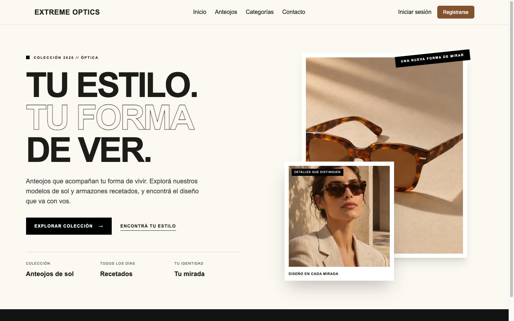
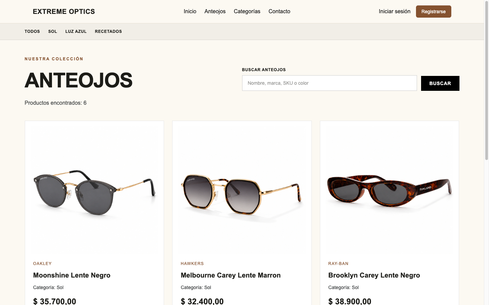
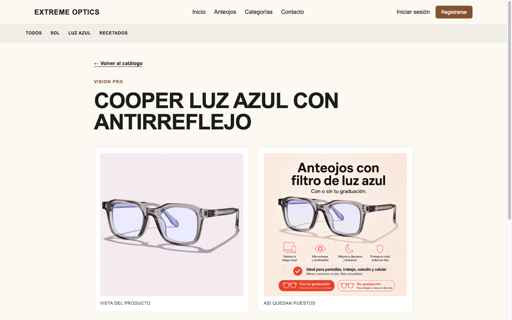
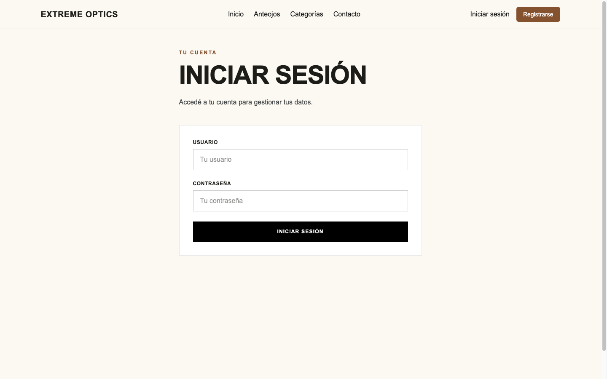

# Extreme Optics — Frontend

Aplicación web de **Extreme Optics**, una óptica que ofrece anteojos de sol, recetados y con filtro de luz azul. Fue desarrollada como Examen Final Integrador 2026 de Programación III con Next.js (App Router) y consume la API REST que el grupo construyó en Ingeniería de Software con Django y Django REST Framework.

Los visitantes pueden recorrer el catálogo, buscar y filtrar anteojos y ver el detalle de cada modelo. El personal autorizado inicia sesión para administrar el catálogo.

- **API consumida:** https://github.com/lneira1754/EFI_ING_API
- **Documentación de la API (Swagger, entorno local):** http://127.0.0.1:8000/api/docs/

## Enlaces de entrega

- **Aplicación desplegada:** https://extreme-optics-delta.vercel.app
- **Tablero Kanban (Trello):** https://trello.com/b/u1t3s0lA/extreme-optics-efi
- **Repositorio frontend:** https://github.com/Magucero/extremeOptics

## Integrantes

- Neira Leonardo
- Pereira Thomas
- Ramón Joaquín Rodriguez
- Perez Lucas

## Tecnologías

- Next.js 16 (App Router), React 19 y JavaScript
- Tailwind CSS 4
- React Hook Form + Zod (`@hookform/resolvers`)
- Context API para la sesión del usuario
- Autenticación JWT contra la API (SimpleJWT)

## Ejecución local

Requisitos: Node.js y npm compatibles con la versión de Next.js declarada en `package.json`, y la API del grupo en ejecución.

```bash
git clone https://github.com/Magucero/extremeOptics.git
cd extremeOptics
npm install
npm run dev
```

Abrir http://localhost:3000.

### Variables de entorno

Crear un archivo `.env.local` en la raíz del proyecto:

```env
API_BASE_URL=http://127.0.0.1:8000/api
```

| Variable | Descripción |
| --- | --- |
| `API_BASE_URL` | URL base de la API Django, sin barra final. Solo se lee en el servidor (no lleva el prefijo `NEXT_PUBLIC_`). |

En producción (Vercel), `API_BASE_URL` debe apuntar a la API publicada; una dirección `127.0.0.1` no es accesible desde Vercel.

## Tests

```bash
npm run test
```

> _PENDIENTE: el script `test` y las pruebas unitarias todavía no están configurados en `package.json`._

## Funcionalidades y rutas

| Ruta | Descripción |
| --- | --- |
| `/` | Inicio |
| `/anteojos` | Catálogo con búsqueda y paginación |
| `/anteojos/sol`, `/anteojos/luz-azul`, `/anteojos/recetados` | Catálogo filtrado por categoría (rutas anidadas) |
| `/anteojos/[id]` | Detalle de un anteojo (ruta dinámica) |
| `/categorias` | Categorías del catálogo |
| `/contacto` | Contacto |
| `/login` | Inicio de sesión |
| `/registro` | Registro de usuarios (_pendiente_) |
| `/dashboard` | Panel de administración |
| `/dashboard/anteojos/nuevo` | Alta de anteojo |
| `/dashboard/anteojos/[id]/editar` | Edición de anteojo (ruta dinámica) |

## Arquitectura

```text
Navegador ──► /api/* (route handlers de Next.js) ──► API Django REST
               leen la cookie httpOnly y agregan
               "Authorization: Bearer <token>"
```

- **Autenticación:** `/api/auth/login` obtiene los tokens JWT de `/api/token/` y los guarda en cookies `httpOnly`, de modo que el JavaScript del navegador no tiene acceso al token. `/api/auth/session` devuelve el usuario actual y `/api/auth/logout` cierra la sesión.
- **Estado global:** `AuthProvider` (`src/components/auth/AuthProvider.jsx`) expone la sesión con `createContext` y el hook `useAuth`.
- **Formularios:** `LoginForm` y `AnteojoForm` usan React Hook Form con esquemas de Zod y muestran tanto los errores de validación como los errores devueltos por la API.
- **Server y Client Components:** las páginas de catálogo y las tarjetas se renderizan en el servidor; los formularios, la barra de navegación y el proveedor de sesión son Client Components porque necesitan estado, eventos o hooks.
- **Carga y errores:** `/anteojos` incluye `loading.jsx` y `error.jsx`; `not-found.jsx` cubre las rutas inexistentes.

```text
src/
├── app/
│   ├── api/            # Route handlers: auth, anteojos, catalogos
│   ├── anteojos/       # Catálogo, subcategorías, detalle, layout, loading, error
│   ├── dashboard/      # Panel de administración y su layout
│   ├── categorias/ contacto/ login/ registro/
│   ├── layout.js       # Layout raíz con AuthProvider y Navbar
│   └── not-found.jsx
├── components/         # Componentes reutilizables (auth/, dashboard/)
└── services/           # Acceso a datos
```

## Capturas

_COMPLETAR: agregar capturas de la aplicación en funcionamiento, por ejemplo:_

<!--





-->

## Flujo de trabajo

El equipo organiza las tareas en un tablero Kanban de **Trello**, donde cada tarjeta avanza por las etapas de pendiente, en curso y terminada.

El repositorio usa las ramas `main`, `develop` y ramas de funcionalidad, integradas mediante pull requests.
